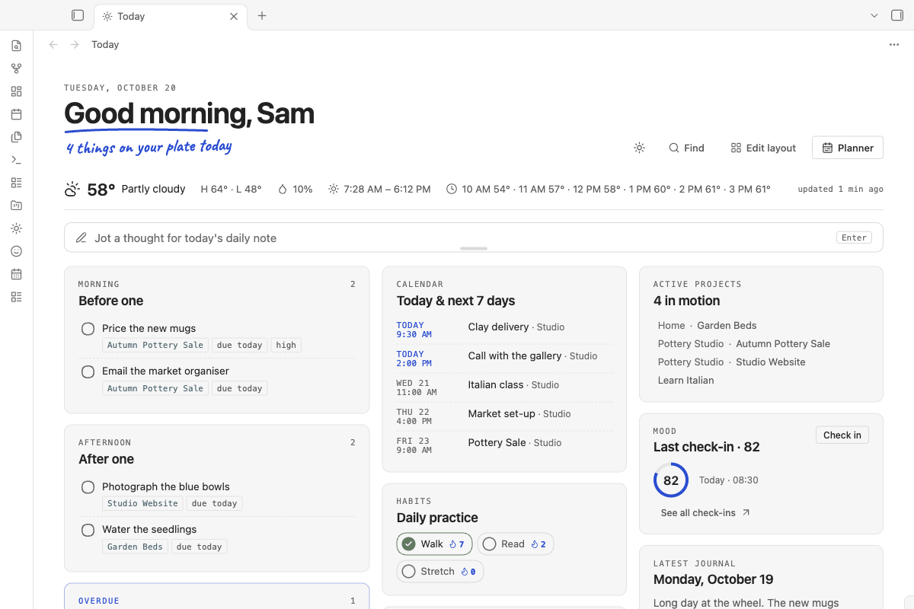
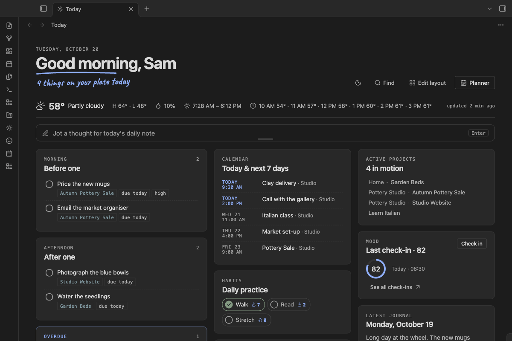
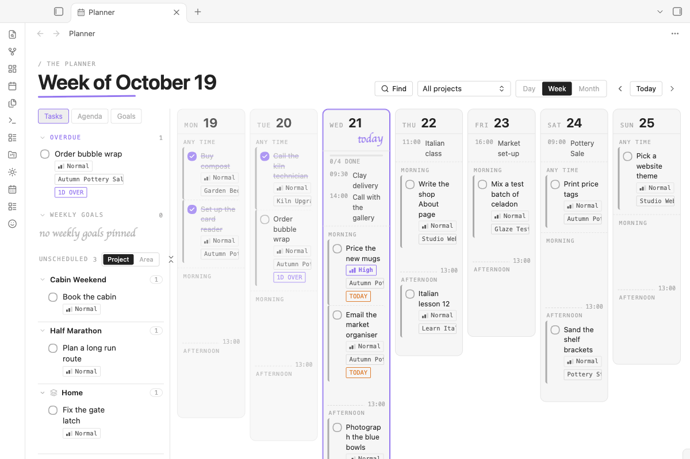
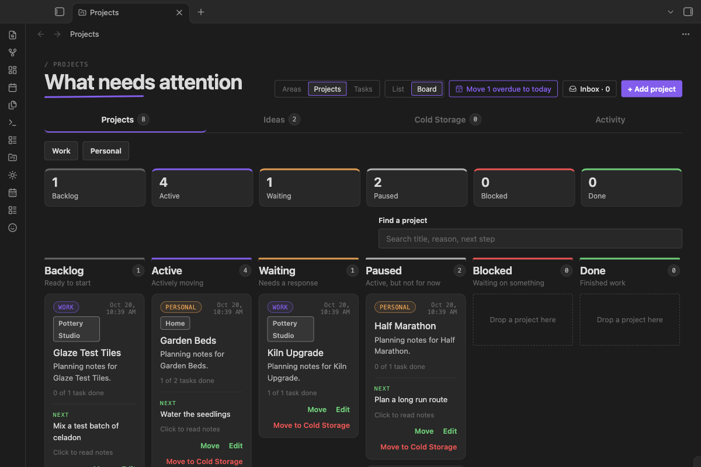
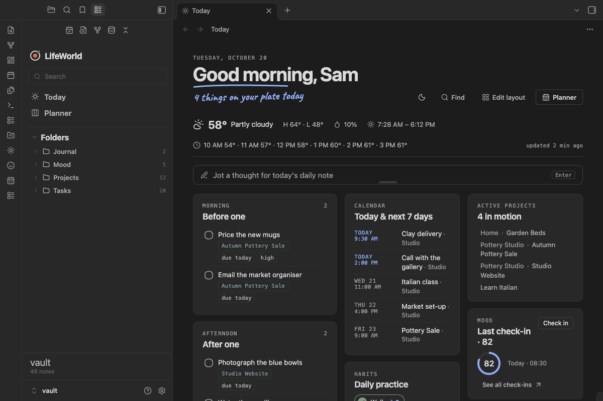
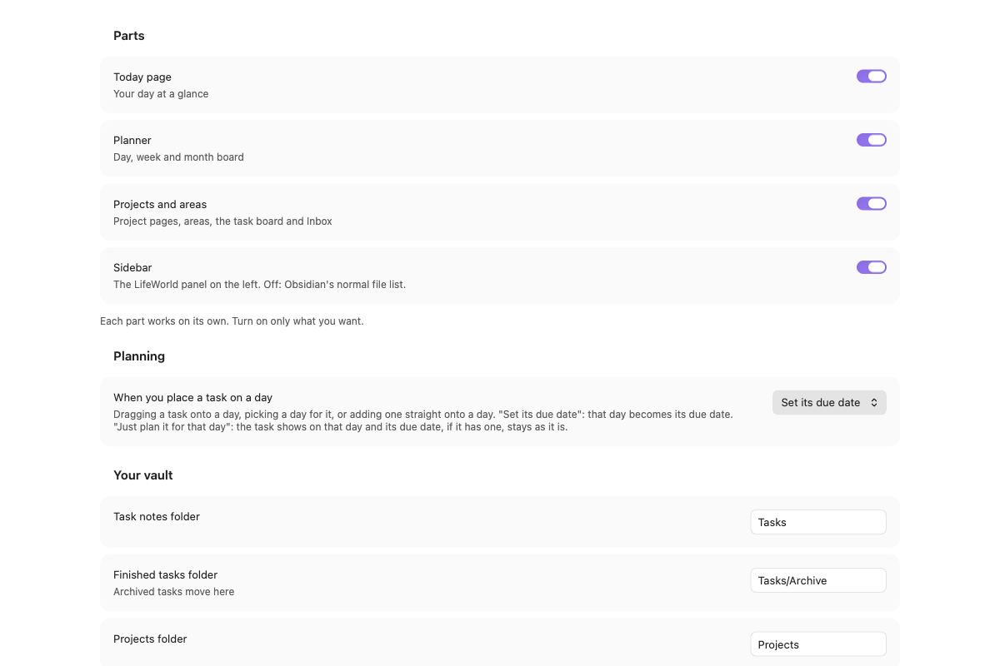

# LifeWorld

**Built on TaskNotes.** LifeWorld's task engine contains code ported from
[TaskNotes](https://github.com/callumalpass/tasknotes) and
[@tasknotes/model](https://github.com/callumalpass/tasknotes-model) by Callum Alpass (MIT License), and
it reads and writes task notes in the same format, so both plugins can work on the same notes. Thank
you, Callum. Full notice: [THIRD_PARTY_NOTICES.md](THIRD_PARTY_NOTICES.md).

LifeWorld turns your vault into a planner: a Today page for the day ahead, a Planner for the day, week
and month, a page for every project and area, and a sidebar that keeps it all one click away. Every
part can be switched on or off, so you can run only the Today page, only the Planner, or all of it.
Tasks stay plain Markdown notes with properties, so you can read, search and edit them like any other
note, and they are still there if you turn LifeWorld off.

## The parts

Open **Settings → LifeWorld → Parts** and switch on the ones you want. Each works on its own. The task
engine runs whenever the Today page, the Planner or Projects is on.

### Today page

Your day on one page. Pick the cards you want, drag them where you like with **Edit layout** on the
page, and remove the ones you don't use (removing a card only hides it). The cards:

- Weather for your town, the next hours or the next days, and tides if you live by the sea
- Quick capture, which drops a thought into today's daily note
- Morning tasks, afternoon tasks, today's checkbox tasks, and everything overdue
- Calendar: today and the next 7 days, from calendar links you add
- Habits: tick today's habits and watch the streak grow
- Mood: a short check-in and a page that shows how your weeks went
- World clock: your time and any places you add
- Active projects, recent notes, pinned shortcuts
- Latest journal entry, and a journal box that writes a line into today's daily note
- A Planner shortcut

A new install starts with Quick capture, the task cards, Calendar, Recent notes, Mood, Habits and
Active projects. The rest are one click away under **Settings → LifeWorld → Today page**.

### Planner

Your day, week or month as a board. Drag tasks onto a day, then into the morning or the afternoon.
Undated tasks wait in a list until you place them, and calendar events show next to your tasks.
Placing a task on a day sets its due date, or, if you prefer, only plans it for that day and keeps the
due date as it is (**Settings → LifeWorld → Planning**).

### Projects and areas

Your projects, split into work and personal, as a list or as a board by status, each with its own page
of tasks and notes. Areas hold ongoing work that never finishes, like a studio or your home, with the
projects and one-off tasks that belong to it. An Inbox collects tasks with no project or date yet.

### Sidebar

A panel on the left with search, Today and the Planner at the top, then your folders with a note count
on each. Drag a note onto a folder to move it, and pick how each folder sorts. Turn the Sidebar off and
Obsidian's normal file list comes back.

## Where your tasks come from

LifeWorld reads one task source at a time (**Settings → LifeWorld → Tasks**):

- **LifeWorld's own task notes**: one note per task, in the TaskNotes format. If the TaskNotes plugin
  is installed, you can let it do the writing instead.
- **Checkboxes** in any note, including the Tasks plugin's date and priority signs.
- **Todoist** or **ClickUp**, with your own API token.
- **Things 3**, on a Mac only.

Add a task by typing a sentence like `call Max friday 3pm !high`; LifeWorld picks out the day,
the time and the priority. Tasks can repeat, wait on other tasks, and move to an archive folder when
they are done. One button moves everything overdue to today, with Undo.

## Getting started

1. In Obsidian, open **Settings → Community plugins → Browse**, search for "LifeWorld", select
   **Install**, then **Enable**.
2. Open **Settings → LifeWorld**. Under **Parts**, switch on the parts you want.
3. Under **Your vault**, check the folders. A new install uses `Tasks` (finished ones in `Tasks/Archive`),
   `Projects`, `Goals`, `Habits`, `Journal` and `Mood`, and your settings from Obsidian's Daily notes plugin. Point them at your own folders if
   you already have them. The names of the task properties can be changed there too.
4. Select the sun icon in the ribbon to open the Today page, or run **LifeWorld: Open today** from the
   command palette.

LifeWorld works on Obsidian for desktop, iPhone, iPad and Android. Things 3 is offered only on a Mac.

## Your data and the network

There is no account, no payment and no tracking of any kind. LifeWorld reads and writes notes inside
your vault and keeps its settings in its own plugin folder. API tokens, the Stormglass key and calendar
links are kept on each device in Obsidian's local storage, never in the settings file or a note, so
Obsidian Sync and git backups do not carry them.

LifeWorld connects to the internet only for features you switch on:

| Feature | Service | What is sent |
| --- | --- | --- |
| Weather on the Today page | [Open-Meteo](https://open-meteo.com) forecast (`api.open-meteo.com`), free, no account | The latitude and longitude of the town you picked |
| Tides (part of Weather) | Open-Meteo marine (`marine-api.open-meteo.com`), or [Stormglass](https://stormglass.io) (`api.stormglass.io`) with your own key, at most once a day | The same latitude and longitude |
| Town search (Weather) and place search (World clock) | Open-Meteo geocoding (`geocoding-api.open-meteo.com`) | The letters you type, from 3 letters on |
| Calendar | The calendar links you add (Google, Apple, Outlook or any ICS address) | A request to each link, every 30 minutes |
| Todoist tasks | Todoist (`api.todoist.com`) with your token | Your token; reads your tasks and writes the changes you make |
| ClickUp tasks | ClickUp (`api.clickup.com`) with your token | Your token; reads your tasks and writes the changes you make |

With these off, LifeWorld makes no network requests. If you pick Things 3, LifeWorld talks to the
Things app on your Mac through AppleScript (macOS asks you to allow it once); nothing goes online.

## Support

Found a bug or have an idea? Please [open an issue](https://github.com/B0xfan/lifeworld/issues). I read
every one.

LifeWorld is free. If it helps you and you would like to say thanks, you can
[buy me a coffee](https://buymeacoffee.com/workbenchgoods).

## Licence

MIT, see [LICENSE](LICENSE). LifeWorld also bundles ical.js (Mozilla Public License 2.0, unmodified)
and four handwriting fonts under the SIL Open Font License; their notices are in
[THIRD_PARTY_NOTICES.md](THIRD_PARTY_NOTICES.md) and at the end of `main.js`.
